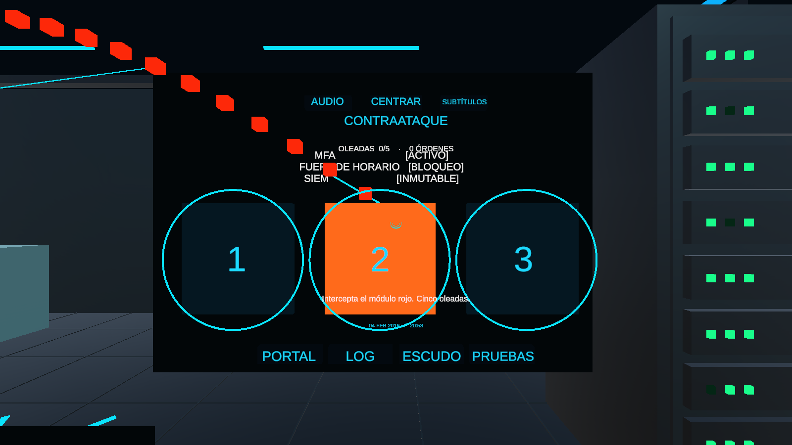

# Nightfall VR

Juego de ciberseguridad para Android con modo táctil y visor Google Cardboard. Investiga el incidente del centro de datos, recupera tres evidencias, activa los controles y detén cinco oleadas antes de comparar el resultado del ataque con la defensa.

## Jugar en Android

Descarga `NightfallVR-3.apk` desde la [versión 3.0](https://github.com/MarcoAntonioFuentes/NightfallVR/releases/tag/v3.0). Requiere Android 8 o posterior y un procesador ARM64. Consulta la [guía de instalación](Builds/Android/COMO-INSTALAR.txt).

Toca para actuar y gira el celular para mirar. Si tu equipo carece de giroscopio, arrastra para mirar. Con un visor, elige **Modo visor**, configura las lentes con el QR y apunta con la mirada a una acción.

## Abrir el proyecto

1. Clona este repositorio y agrega la carpeta del proyecto en Unity Hub con **Unity 6.3 (6000.3.23f1)**.
2. Abre `Assets/CyberShield/Scenes/DataCenter_Nightfall_Android.unity` y pulsa **Play**. Usa el botón derecho del ratón para mirar y el clic izquierdo o **E** para seleccionar.
3. Para comprobar la misión completa, usa **CyberShield → Nightfall Android → Validar misión completa**.
4. Para generar un APK, instala **Android Build Support**, **Android SDK & NDK Tools** y **OpenJDK** desde Unity Hub. Comprueba sus rutas en **Preferences → External Tools**, activa el destino Android y usa **CyberShield → Nightfall Android → Generar APK**.

El repositorio incluye la escena, los scripts, el audio listo para usar y el paquete Cardboard integrado. Consulta la [documentación de la misión](Assets/CyberShield/NIGHTFALL-ANDROID.md) para ver los controles, los créditos y la configuración de Android.
